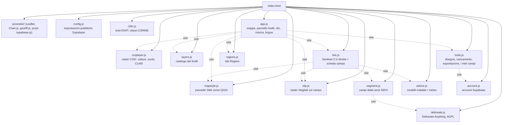
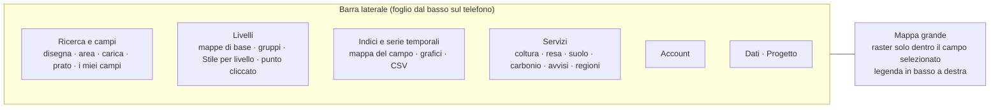
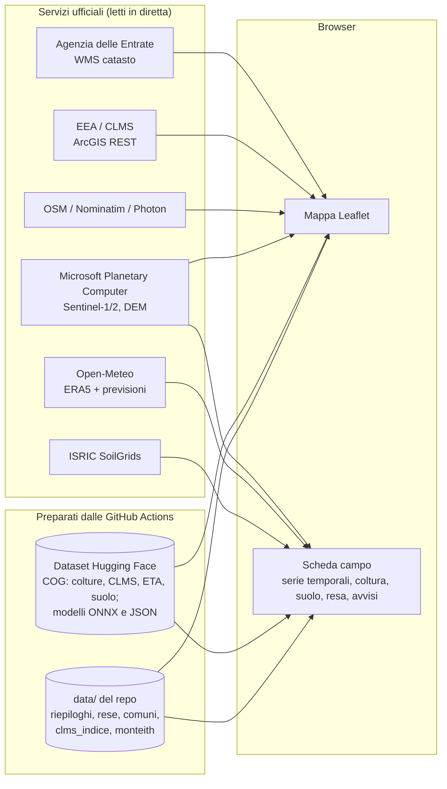
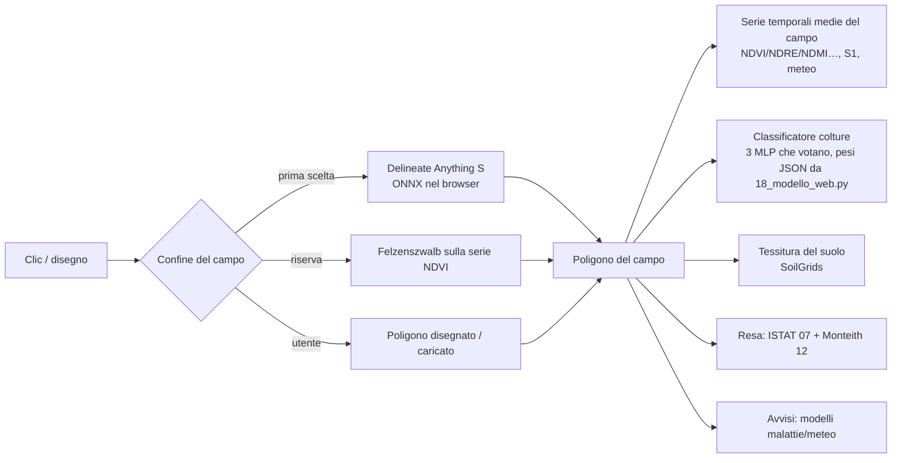
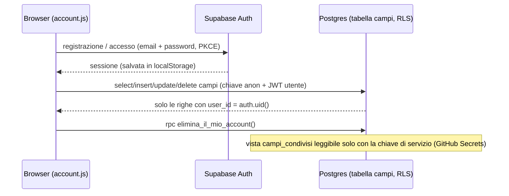

# Come funziona Columella

Columella è un **sito statico** (GitHub Pages: HTML + JavaScript semplice, nessun build, nessun server proprio).
Tutti i calcoli per l'utente avvengono **nel browser**; i lavori pesanti e lenti girano **una volta nelle GitHub Actions**
(script Python in `pipeline/`) e i risultati sono pubblicati come file (in `data/` di questo repo o nel dataset Hugging Face
`Bradipo92/campi-aperti-data`). Versione inglese: [HOW_IT_WORKS.md](HOW_IT_WORKS.md).

## 1. Struttura del sito

### Impaginazione

Nessun pannello copre la mappa: strumenti, schede e grafici stanno nelle sezioni a scomparsa della barra laterale. Selezionando un campo
la mappa si centra su di esso, tutti i livelli raster sono mostrati **solo dentro il poligono** (`clip-path` CSS sul riquadro Leaflet
`rasters`, `clip.js`) e le statistiche (media, min, max, dev. std.) sono calcolate sull'intero campo. Il pannello **Stile** (`mapstyle.js`,
ripreso da Prognostica) offre scala di colori, inversione, minimo/massimo (predefiniti, min–max del campo, percentili 2–98 %, media ± 2 dev.
std., manuali), classi continue / a intervalli uguali / quantili, trasparenza, colore per nessun dato, istogramma dei valori del campo e
legenda aggiornata; lo stile di ogni livello è salvato nel browser (`localStorage`, chiave `columella.style.<id del livello>`).
I mosaici Sentinel-2 per periodo sono colorati dal server: per loro solo scala, limiti manuali e trasparenza.

Gli script sono caricati in quest'ordine da `index.html` e condividono variabili globali (`LANG`, `Live`, `Tools`, `Account`, …).
Il suffisso `?v=NN` di ogni script obbliga i browser a ricaricarlo dopo una modifica.

## 2. Flusso dei dati

### Catasto
`layers.js` (`type: "catasto"`) → WMS INSPIRE dell'Agenzia delle Entrate, tasselli chiesti in EPSG:4258. Le particelle si vedono solo
a grande scala; il clic apre la scheda della particella in una nuova finestra (il servizio non ha CORS).

### Copernicus
- **Layer CLMS / EEA** (CORINE, CLC+, densità chiome, prati, fenologia…): `layers.js` → ArcGIS `export`/`exportImage`, `identify`, `legend`.
- **Variabili biogeofisiche ed ETA** (NDVI, LAI, FAPAR, ET…): `pipeline/16_clms_italia.py` le ritaglia sull'Italia in COG → Hugging Face;
  `17_indice_clms.py` scrive `data/clms_indice.json` (date disponibili); `croplayer.js` legge solo i byte necessari (HTTP range) con geotiff.js.
- **HRL Crop Types**: `01`→`02` producono un COG all'anno (`crop_types/cty_AAAA_italia_3035.tif`), disegnato da `CropLayer`.
- **Sentinel-2 in diretta**: `live.js` registra un mosaico su Planetary Computer (ultimi 10–90 giorni, nuvole < 20 %) per colori naturali/falsi e indici.

### Meteo
Open-Meteo (archivio ERA5 + previsioni a 7 giorni) è chiamato direttamente dal browser per il campo scelto (`live.js`, `advice.js`).
I riepiloghi regionali vengono da `04_meteo_celle.py` → `05_bilancio_regioni.py` → `data/riepiloghi.json` (`regions.js`).

### Campi e modelli delle colture

I valori sono sempre **medie sull'intero campo** (nuvole e ombre escluse con la classe SCL di Sentinel-2).
Il classificatore è addestrato offline (`13_dataset_v2.py` → `14_addestra_v2.py` → `18_modello_web.py`).

## 3. Supabase (account facoltativi)

- `js/config.js` contiene solo URL e chiave anon **pubblici**; se è vuoto gli account sono spenti e i campi restano in `localStorage`.
- La sicurezza sta in `supabase/schema.sql` (Row Level Security, al massimo 500 campi per utente). Attivazione: `SUPABASE.md`. Informativa: `privacy.html`.
- La pagina ha una Content-Security-Policy (`index.html`): script solo dal sito, da jsDelivr (onnxruntime-web, con SRI) e da GoatCounter;
  richieste di rete solo verso i servizi elencati. Un nuovo servizio di dati va aggiunto anche lì.

## 4. File → cosa fa

| File | Cosa fa |
|---|---|
| `index.html` | Scheletro della pagina, carica gli script in ordine |
| `css/style.css` | Stile |
| `js/config.js` | Impostazioni pubbliche Supabase (URL, chiave anon) |
| `js/i18n.js` | Testi EN/IT, nomi delle classi CORINE, catalogo "in arrivo" |
| `js/layers.js` | Catalogo dei livelli (gruppi, URL, testi, fonti) |
| `js/mapstyle.js` | Pannello Stile: scale, limiti, classi, istogramma, legenda, salvato per livello |
| `js/clip.js` | Ritaglia i raster sul campo selezionato e centra la mappa sul campo |
| `js/vendor/` | Copie locali di Leaflet, supabase-js, Chart.js, geotiff.js, proj4 (licenze in `LICENSES.md`) |
| `js/app.js` | Mappa, mappe di base, sezioni della barra laterale, pannello livelli e stili, statistiche sul campo, legenda, clic sul punto, ricerca, lingua, URL condivisibile |
| `js/croplayer.js` | Raster COG nel browser: Crop Types, suolo, CLMS; scale di colori |
| `js/live.js` | Livelli Sentinel-2/1 in diretta, scheda campo: serie, coltura, suolo, resa, bilancio idrico, CSV |
| `js/segment.js` | Divisione in campi dalla serie NDVI Sentinel-2 (riserva) |
| `js/delineate.js` | Confini dei campi con Delineate Anything S (ONNX, AGPL-3.0, scaricato al momento dell'uso) |
| `js/advice.js` | Avvisi agronomici per coltura dal meteo orario |
| `js/regions.js` | Tab "Regioni": riepiloghi per regione, coltura e periodo; Monteith vs ISTAT |
| `js/tools.js` | Disegno/caricamento di campi e mappe, esportazione area, "i miei campi", prato, benvenuto |
| `js/account.js` | Account Supabase, campi salvati, esportazione e cancellazione |
| `supabase/schema.sql` | Tabella `campi`, regole RLS, massimo 500 campi per utente, cancellazione account, vista condivisa |
| `pipeline/00`–`02` | Crop Types: download da CDSE, COG Italia, caricamento su HF |
| `pipeline/03`–`05` | Superfici per blocco di 1 km, celle meteo, bilanci regionali → `data/riepiloghi.json` |
| `pipeline/06` | ET reale Copernicus per regione e coltura |
| `pipeline/07` | Rese ISTAT per provincia → `data/rese.json` |
| `pipeline/10`, `12` | NDVI per provincia e modello di resa di Monteith vs ISTAT |
| `pipeline/11` | Esporta Delineate Anything S in ONNX (AGPL-3.0) |
| `pipeline/13`, `14`, `18` | Classificatore colture: dataset, addestramento, pesi per il browser |
| `pipeline/15` | Indice dei comuni per la ricerca → `data/comuni.json` |
| `pipeline/16`, `17` | Variabili CLMS sull'Italia (COG) e indice delle date |
| `pipeline/19` | Mappe del suolo SoilGrids per l'Italia (COG) |
| `pipeline/classi.py` | Classi Crop Types e coefficienti colturali |
| `pipeline/hf_sync.py` | Sincronizza le cartelle di lavoro con il dataset Hugging Face |
| `.github/workflows/*.yml` | GitHub Actions: pipeline, raccolta contributi, prova del sito |
