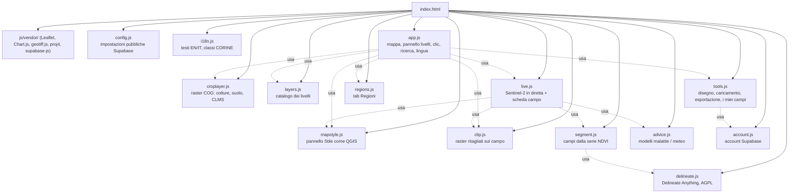
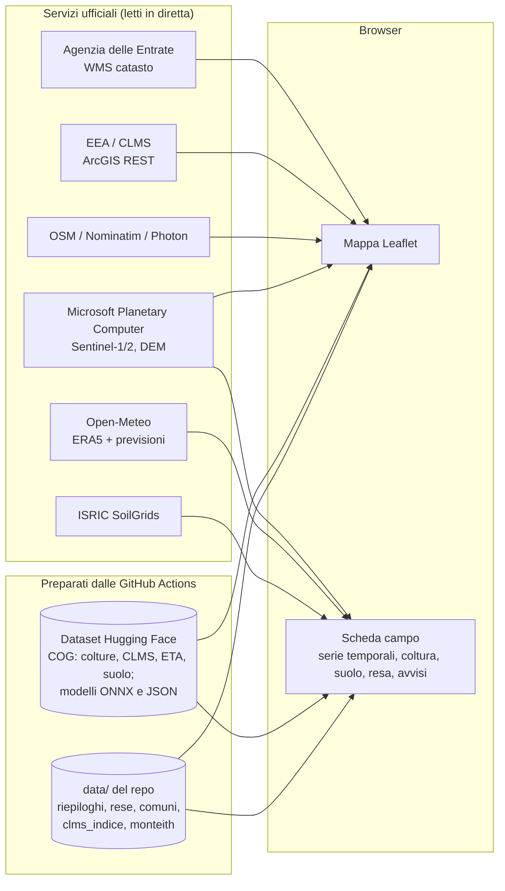
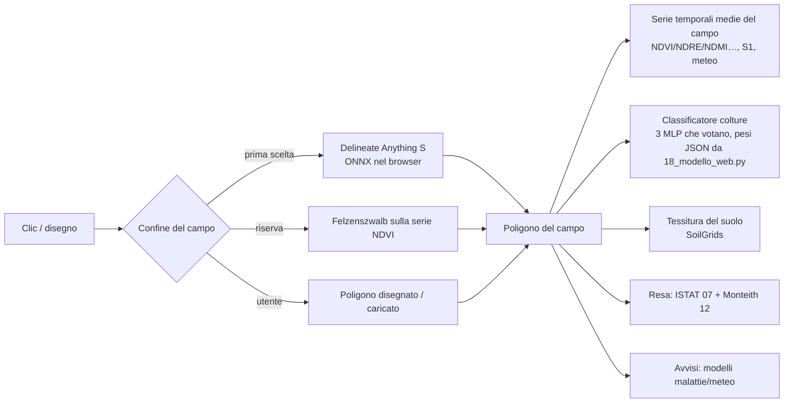
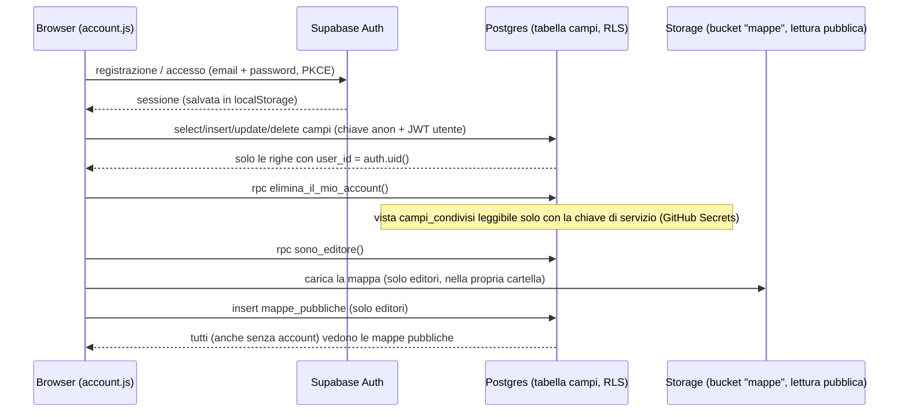

# Come funziona Columella

Columella è un **sito statico** (GitHub Pages: HTML + JavaScript semplice, nessun build, nessun server proprio).
Tutti i calcoli per l'utente avvengono **nel browser**; i lavori pesanti e lenti girano **una volta nelle GitHub Actions**
(script Python in `pipeline/`) e i risultati sono pubblicati come file (in `data/` di questo repo o nel dataset Hugging Face
`Bradipo92/campi-aperti-data`). Versione inglese: [HOW_IT_WORKS.md](HOW_IT_WORKS.md).

## 1. Struttura del sito



### Impaginazione

```mermaid
flowchart LR
  subgraph Barra["Barra laterale a tab (foglio dal basso sul telefono)"]
    t1[Mappe<br/>mappa di base (spenta / grigi) · campi e colture · Sentinel-2 · CLMS · suolo · catasto ·<br/>mappe pubbliche · dati · progetto]
    t2[Campi<br/>rileva campi e colture · strumenti · campi selezionati C1, C2… ·<br/>mappa del campo · serie · confronto tra campi · servizi · account]
    t3[Province<br/>rese ISTAT e Monteith]
    t4[Regioni<br/>acqua · rese ISTAT e Monteith]
  end
  Barra --- M[Mappa grande<br/>raster solo dentro i campi selezionati, resto velato<br/>finestra dei livelli spostabile · legenda]
```

- **Campi selezionati** (`clip.js`): il clic seleziona un campo; **Ctrl/Maiusc + clic** (o "aggiungi campi") lo aggiunge con un id
  temporaneo (C1, C2, …) e un colore. Tutti i raster sono mostrati **solo dentro i poligoni selezionati** (`clip-path` CSS sul riquadro
  Leaflet `rasters`), il resto della mappa è velato e le statistiche usano tutti i pixel dei campi selezionati. Ogni campo tiene i suoi dati
  (`live.js`: serie, meteo, suolo…); gli id passano da un campo all'altro senza riscaricare.
- **Confronto tra campi**: una variabile nel tempo con una linea per id; **grafico a dispersione** dei pixel di due mappe (es. LAI contro
  NDVI) dall'immagine Sentinel-2 serena più vicina, colorato per id, con la correlazione; tutto scaricabile in CSV.
- **Rileva campi e colture** nell'area visibile (al massimo circa 6 × 6 km) o in un rettangolo disegnato: segmentazione + coltura
  Copernicus per campo, campi colorati per coltura; il clic su un campo lo seleziona.
- **Tab Mappe**, in quest'ordine: mappa di base (si può spegnere o mostrare in scala di grigi secondo la luminosità), **Campi e colture**
  (mappa delle colture e prodotto con cui dare la coltura ai campi: Copernicus Crop Types di un anno, oppure il modello Columella su un'annata
  scelta), **Sentinel-2**, **CLMS** (gruppi come nel portafoglio CLMS: parametri biogeofisici, fenologia e produttività HR-VPP, serie lunghe
  MR-VPP/LPD, copertura del suolo, High Resolution Layers di praterie, alberi e acqua), **Suolo**, **Catasto** (`MAP_SECTIONS` in `layers.js`).
- **Finestra dei livelli**: finestra spostabile sulla mappa con i livelli accesi (in cima il primo: nascondi/mostra, sopra/sotto, trascina,
  togli) e i campi selezionati (mostra nel pannello, vai, togli, velo sul resto della mappa sì/no). L'ordine vale tra i raster; il catasto resta sopra.
- **Stile** (`mapstyle.js`, ripreso da Prognostica): scala di colori, inversione, minimo/massimo (predefiniti, min–max del campo,
  percentili 2–98 %, media ± 2 dev. std., manuali), classi continue / a intervalli uguali / quantili, trasparenza, colore per nessun dato,
  istogramma dei valori del campo e legenda; salvato per livello nel browser (`columella.style.<id del livello>`). I mosaici Sentinel-2
  per periodo sono colorati dal server (solo scala, limiti manuali e trasparenza).

## 2. Flusso dei dati



### Catasto
`layers.js` (`type: "catasto"`) → WMS INSPIRE dell'Agenzia delle Entrate, tasselli chiesti in EPSG:4258. Le particelle si vedono solo
a grande scala; il clic apre la scheda della particella in una nuova finestra (il servizio non ha CORS).

### Copernicus
- **Layer CLMS / EEA** (CORINE, CLC+, densità chiome, prati, fenologia…): `layers.js` → ArcGIS `export`/`exportImage`, `identify`, `legend`.
- **Variabili biogeofisiche ed ETA** (NDVI, LAI, FAPAR, ET…): `pipeline/16_clms_italia.py` le ritaglia sull'Italia in COG → Hugging Face;
  `17_indice_clms.py` scrive `data/clms_indice.json` (date disponibili); `croplayer.js` legge solo i byte necessari (HTTP range) con geotiff.js.
- **HRL Crop Types**: `01`→`02` producono un COG all'anno (`crop_types/cty_AAAA_italia_3035.tif`), disegnato da `CropLayer`.
- **Sentinel-2 in diretta**: `live.js` registra un mosaico su Planetary Computer (ultimi 10–90 giorni, nuvole < 20 %) per colori naturali/falsi e indici.

### Meteo
Open-Meteo (archivio ERA5 + previsioni a 7 giorni) è chiamato direttamente dal browser per il campo scelto (`live.js`, `advice.js`).
I riepiloghi regionali vengono da `04_meteo_celle.py` → `05_bilancio_regioni.py` → `data/riepiloghi.json` (`regions.js`).

### Campi e modelli delle colture



I valori sono sempre **medie sull'intero campo** (nuvole e ombre escluse con la classe SCL di Sentinel-2).

**Resa annata per annata** (tab Campi → Servizi): per ogni annata (nov–ott) con la mappa colture Copernicus il browser legge l'NDVI
Sentinel-2 medio del campo e la radiazione ERA5 e applica il modello di Monteith (tarato con lo stesso fattore delle province), accanto alla
resa ISTAT della provincia per la stessa coltura e annata. **Tab Province / Regioni**: Monteith contro ISTAT per provincia
(`data/monteith_province.json`) e per regione (province pesate sulla superficie ISTAT, nomi delle regioni da `data/province.json`). **Fonte dei campi della coltura**, a scelta
in entrambe le tab: mappa Copernicus Crop Types (pixel 200 m puri, script 10 → 12) o **classificatore delle colture** (le 3 reti MLP dello
script 18 applicate alle variabili mensili Sentinel-2/Sentinel-1/DEM a 200 m, pixel sicuri con probabilità ≥ 0,6, script 20 → 12 con
`FONTE=classificatore`, `data/monteith_province_cls.json`, anche con la superficie stimata dal classificatore). Il confronto col
classificatore si calcola provincia per provincia con il workflow `monteith-classificatore.yml`: **in automatico ogni mese** per tutte le annate (2018–2025) e tutta
Italia divisa in 4 gruppi di regioni (`PARTE=k/4`, circa 2 ore ciascuno, 8 lavori in parallelo), oppure a mano per un'annata e alcune sigle.
Ogni esecuzione scrive file con la propria etichetta e il momento del calcolo (`calcolato`); lo script 12 tiene il calcolo più recente per
provincia e annata ed esporta il tempo di calcolo (`tempi`), che le tab Province/Regioni mostrano insieme alla superficie stimata dal
classificatore contro quella ISTAT (barre per annata e dispersione tra province). **Taratura**: per coltura, fattore = mediana di ISTAT /
modello su tutte le province e annate con dati ISTAT; con poche province calcolate dal classificatore si usa il fattore di Copernicus.

Nota: il classificatore delle colture **non** è un modello YOLO: è un insieme di 3 reti MLP (script 13 → 18). YOLO si usa solo per i
confini dei campi (Delineate Anything S, YOLO11n-seg).

**Acqua disponibile per le piante (PAW)**: funzioni di pedotrasferimento di Saxton & Rawls (2006) (`saxtonRawls` in `croplayer.js`) da
sabbia, argilla e sostanza organica (SOC × 1,724): capacità di campo θ33, punto di appassimento θ1500 e PAW = θ33 − θ1500 (mm per metro).
Nella scheda suolo del campo e come livello "Acqua disponibile per le piante (PAW)", calcolato pixel per pixel nel browser dai COG
SoilGrids (`CogLayer` con `urls` + `combine`).
Il classificatore è addestrato offline (`13_dataset_v2.py` → `14_addestra_v2.py` → `18_modello_web.py`).

## 3. Supabase (account facoltativi)



**Mappe pubbliche**: gli utenti che il proprietario segna come *editori* (tabella `editori`, modificabile solo dal pannello Supabase) caricano
mappe GeoTIFF / GeoJSON / KML (al massimo 50 MB) con titolo, fonte e licenza; tutti le vedono in **Mappe → Mappe pubbliche** e le aprono nel
browser. L'account del proprietario (email nella tabella privata `impostazioni`, chiave `email_proprietario`) è sempre editore. In Campi → Le mie mappe gli editori possono **rendere permanente** (pubblicare) una mappa caricata. RLS: tutti leggono `mappe_pubbliche`; inserimento, modifica e cancellazione solo per gli editori e solo sulle proprie righe; scrittura
nello storage solo nella cartella dell'editore.

- `js/config.js` contiene solo URL e chiave anon **pubblici**; se è vuoto gli account sono spenti e i campi restano in `localStorage`.
- La sicurezza sta in `supabase/schema.sql` (Row Level Security, al massimo 500 campi per utente). Attivazione: `SUPABASE.md`. Informativa: `privacy.html`.
- La pagina ha una Content-Security-Policy (`index.html`): script solo dal sito, da jsDelivr (onnxruntime-web, con SRI) e da GoatCounter;
  richieste di rete solo verso i servizi elencati. Un nuovo servizio di dati va aggiunto anche lì.

## 4. File → cosa fa

| File | Cosa fa |
|---|---|
| `index.html` | Scheletro della pagina, carica gli script in ordine |
| `css/style.css` | Stile |
| `js/config.js` | Impostazioni pubbliche Supabase (URL, chiave anon) |
| `js/i18n.js` | Testi EN/IT, nomi delle classi CORINE, catalogo "in arrivo" |
| `js/layers.js` | Catalogo dei livelli (gruppi, URL, testi, fonti) |
| `js/mapstyle.js` | Pannello Stile: scale, limiti, classi, istogramma, legenda, salvato per livello |
| `js/clip.js` | Campi selezionati (id C1, C2…, colori), raster ritagliati su di essi, resto della mappa velato |
| `js/vendor/` | Copie locali di Leaflet, supabase-js, Chart.js, geotiff.js, proj4 (licenze in `LICENSES.md`) |
| `js/app.js` | Mappa, mappe di base, tab e sezioni della barra laterale, pannello livelli e stili, finestra dei livelli spostabile, statistiche sui campi, legenda, clic sul punto, ricerca, lingua, URL condivisibile |
| `js/croplayer.js` | Raster COG nel browser: Crop Types, suolo, CLMS, PAW (Saxton & Rawls); scale di colori |
| `js/live.js` | Livelli Sentinel-2/1 in diretta; dati per campo selezionato; scheda campo: serie, coltura, suolo, resa (anche annata per annata), bilancio idrico; confronto tra campi e scatter dei pixel; CSV |
| `js/segment.js` | Divisione in campi dalla serie NDVI Sentinel-2 (riserva) |
| `js/delineate.js` | Confini dei campi con Delineate Anything S (ONNX, AGPL-3.0, scaricato al momento dell'uso) |
| `js/advice.js` | Avvisi agronomici per coltura dal meteo orario |
| `js/regions.js` | Tab "Province" e "Regioni": Monteith contro ISTAT per provincia e regione; acqua per regione, coltura e periodo |
| `js/tools.js` | Rilevamento di campi e colture (area visibile o disegnata), disegno/caricamento di campi e mappe, "i miei campi", prato, benvenuto |
| `js/account.js` | Account Supabase, campi salvati, esportazione e cancellazione; mappe pubbliche (elenco, pubblicazione, rimozione) |
| `supabase/schema.sql` | Tabella `campi`, regole RLS, massimo 500 campi per utente, cancellazione account, vista condivisa; editori, mappe pubbliche e bucket `mappe` |
| `pipeline/00`–`02` | Crop Types: download da CDSE, COG Italia, caricamento su HF |
| `pipeline/03`–`05` | Superfici per blocco di 1 km, celle meteo, bilanci regionali → `data/riepiloghi.json` |
| `pipeline/06` | ET reale Copernicus per regione e coltura |
| `pipeline/07` | Rese ISTAT per provincia → `data/rese.json` |
| `pipeline/10`, `12` | NDVI per provincia e modello di resa di Monteith vs ISTAT (`FONTE`: Copernicus o classificatore) |
| `pipeline/11` | Esporta Delineate Anything S in ONNX (AGPL-3.0) |
| `pipeline/13`, `14`, `18` | Classificatore colture: dataset, addestramento, pesi per il browser |
| `pipeline/15` | Indice dei comuni per la ricerca → `data/comuni.json` |
| `pipeline/16`, `17` | Variabili CLMS sull'Italia (COG) e indice delle date |
| `pipeline/20` | Classificatore delle colture sui pixel 200 m delle province scelte → serie NDVI e superfici stimate (per 12 con `FONTE=classificatore`) |
| `pipeline/19` | Mappe del suolo SoilGrids per l'Italia (COG) |
| `pipeline/classi.py` | Classi Crop Types e coefficienti colturali |
| `pipeline/hf_sync.py` | Sincronizza le cartelle di lavoro con il dataset Hugging Face |
| `.github/workflows/*.yml` | GitHub Actions: pipeline, raccolta contributi, prova del sito |
