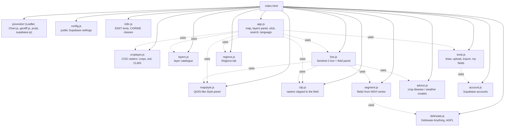
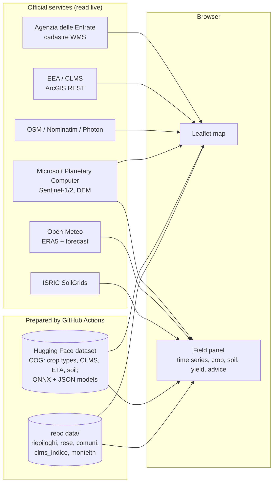
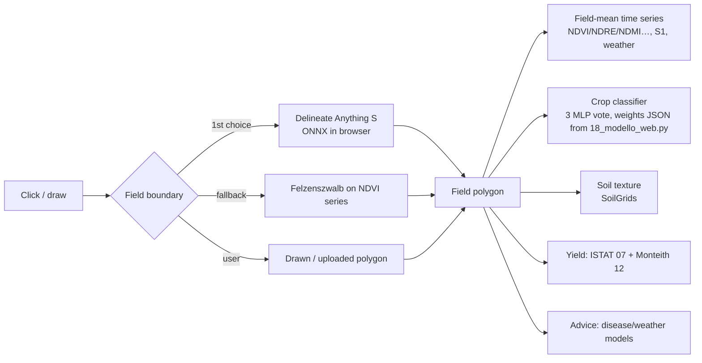
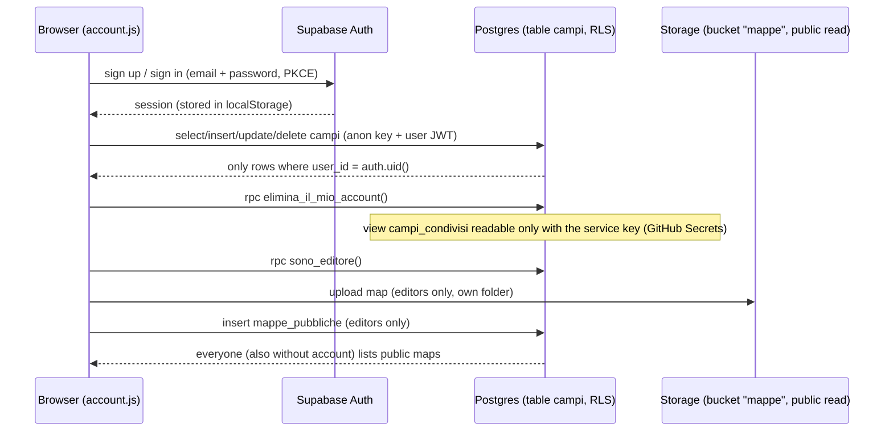

# How Columella works

Columella is a **static website** (GitHub Pages: HTML + plain JavaScript, no build step, no server of its own).
Every computation for the user runs **in the browser**; heavy, slow jobs run **once in GitHub Actions** (Python scripts in
`pipeline/`) and their results are published as files (in `data/` of this repo or in the Hugging Face dataset
`Bradipo92/campi-aperti-data`). Italian version: [COME_FUNZIONA.md](COME_FUNZIONA.md).

## 1. Site structure



### Page layout

```mermaid
flowchart LR
  subgraph Sidebar["Sidebar with tabs (bottom sheet on phones)"]
    t1[Maps<br/>base map (none / greyscale) · fields and crops · Sentinel-2 · CLMS · soil · cadastre ·<br/>public maps · data · about]
    t2[Fields<br/>detect fields and crops · tools · selected fields C1, C2… ·<br/>field map · time series · compare fields · services · account]
    t3[Provinces<br/>ISTAT vs Monteith yields]
    t4[Regions<br/>water balance · ISTAT vs Monteith yields]
  end
  Sidebar --- M[Large map<br/>rasters only inside the selected fields, rest dimmed<br/>movable layer window · legend]
```

- **Selected fields** (`clip.js`): click selects a field; **Ctrl/Shift + click** (or "add fields") adds it with a temporary id (C1, C2, …)
  and a colour. Every raster layer is drawn **only inside the selected polygons** (CSS `clip-path` on the Leaflet pane `rasters`), the rest
  of the map is dimmed, and statistics use all pixels of the selected fields. Each field keeps its own data (`live.js`: series, weather,
  soil…); the id chips switch the panel between fields without downloading again.
- **Compare fields**: one variable over time with one line per field id; pixel **scatter plot** of two maps (e.g. LAI vs NDVI) from the
  closest cloud-free Sentinel-2 image, coloured by field id, with correlation; both downloadable as CSV.
- **Detect fields and crops** in the visible area (≤ about 6 × 6 km) or in a drawn rectangle: segmentation + Copernicus crop per field,
  fields coloured by crop; clicking one selects it.
- **Maps tab**, in this order: base map (can be switched off or shown in greyscale by brightness), **Fields and crops** (crop map and the
  product used for field crops: Copernicus Crop Types of a year, or the Columella model applied to a chosen season), **Sentinel-2**, **CLMS**
  (sub-groups as in the CLMS portfolio: bio-geophysical parameters, HR-VPP phenology and productivity, MR-VPP/LPD long series, land cover,
  High Resolution Layers for grasslands, trees and water), **Soil**, **Cadastre** (`MAP_SECTIONS` in `layers.js`).
- **Layer window**: a movable window on the map lists the layers that are on (top first: hide/show, up/down, drag and drop, remove) and the
  selected fields (show in the panel, zoom, remove, dim the rest of the map on/off). The order works within the raster pane; the cadastre stays on top.
- **Style** (`mapstyle.js`, ported from Prognostica): colour ramp, invert, min/max (default, field min–max, percentiles 2–98 %,
  mean ± 2 std. dev., manual), continuous / equal-interval / quantile classes, opacity, no-data colour, histogram of the field values and a
  live legend; saved per layer in the browser (`columella.style.<layer id>`). Sentinel-2 period mosaics are coloured by the server
  (ramp, manual limits, opacity only).

## 2. Data flow



### Cadastre
`layers.js` (`type: "catasto"`) → WMS INSPIRE of Agenzia delle Entrate, tiles requested in EPSG:4258. Parcels are drawn only at
large scales; a click opens the parcel sheet in a new window (the service has no CORS).

### Copernicus
- **CLMS / EEA layers** (CORINE, CLC+, tree cover, grassland, phenology…): `layers.js` → ArcGIS `export`/`exportImage`, `identify`, `legend`.
- **Biogeophysical variables and ETA** (NDVI, LAI, FAPAR, ET…): `pipeline/16_clms_italia.py` clips them on Italy as COG → Hugging Face;
  `17_indice_clms.py` writes `data/clms_indice.json` (available dates); `croplayer.js` reads only the needed bytes (HTTP range) with geotiff.js.
- **HRL Crop Types**: `01`→`02` build one COG per year (`crop_types/cty_YYYY_italia_3035.tif`), drawn by `CropLayer`.
- **Sentinel-2 live**: `live.js` registers a mosaic on Planetary Computer (last 10–90 days, clouds < 20 %) for natural/false colours and indices.

### Weather
Open-Meteo (ERA5 archive + 7-day forecast) is called directly from the browser for the selected field (`live.js`, `advice.js`).
Regional summaries come from `04_meteo_celle.py` → `05_bilancio_regioni.py` → `data/riepiloghi.json` (`regions.js`).

### Fields and crop models



Values are always **means over the whole field** (clouds and shadows masked with the Sentinel-2 SCL class).

**Yield, season by season** (Fields tab → Services): for every season (Nov–Oct) with a Copernicus crop map, the browser reads the field-mean
Sentinel-2 NDVI and ERA5 radiation and applies the Monteith model (calibrated with the same factor as the provinces), next to the ISTAT
yield of the province for the same crop and year. **Provinces / Regions tabs**: Monteith vs ISTAT per province (`data/monteith_province.json`)
and per region (provinces weighted by ISTAT area, region names from `data/province.json`).

**Plant available water (PAW)**: Saxton & Rawls (2006) pedotransfer functions (`saxtonRawls` in `croplayer.js`) from sand, clay and organic
matter (SOC × 1.724): field capacity θ33, wilting point θ1500 and PAW = θ33 − θ1500 (mm per metre). Shown in the field soil card and as the
map layer "Plant available water (PAW)", computed pixel by pixel in the browser from the SoilGrids COGs (`CogLayer` with `urls` + `combine`).
The crop classifier is trained offline (`13_dataset_v2.py` → `14_addestra_v2.py` → `18_modello_web.py`).

## 3. Supabase (optional accounts)



**Public maps**: users the owner marks as *editors* (table `editori`, edited only from the Supabase dashboard) can upload GeoTIFF / GeoJSON /
KML maps (≤ 50 MB) with title, source and licence; everyone sees them in **Maps → Public maps** and opens them in the browser.
The owner's account (email in the private table `impostazioni`, key `email_proprietario`) is always an editor. In Fields → My maps, editors can **make an uploaded map permanent** (publish it). RLS: anyone reads `mappe_pubbliche`; insert/update/delete only for editors on their own rows; storage writes only in the editor's folder.

- `js/config.js` holds only the **public** URL and anon key; if empty, accounts are off and fields stay in `localStorage`.
- Security is in `supabase/schema.sql` (Row Level Security, at most 500 fields per user). Setup: `SUPABASE.md`. Privacy notice: `privacy.html`.
- The page has a Content-Security-Policy (`index.html`): scripts only from the site, jsDelivr (onnxruntime-web, with SRI) and GoatCounter;
  network requests only to the services listed in the policy. Add a new data service there too.

## 4. File → what it does

| File | What it does |
|---|---|
| `index.html` | Page skeleton, loads scripts in order |
| `css/style.css` | Styles |
| `js/config.js` | Public Supabase settings (URL, anon key) |
| `js/i18n.js` | EN/IT interface texts, CORINE class names, "coming soon" catalogue |
| `js/layers.js` | Layer catalogue (groups, URLs, texts, sources) |
| `js/mapstyle.js` | Style panel: ramps, limits, classes, histogram, legend, saved per layer |
| `js/clip.js` | Selected fields (ids C1, C2…, colours), rasters clipped to them, rest of the map dimmed |
| `js/vendor/` | Local copies of Leaflet, supabase-js, Chart.js, geotiff.js, proj4 (licences in `LICENSES.md`) |
| `js/app.js` | Map, base maps, sidebar tabs and sections, layer panel and styles, movable layer window, field statistics, legend, point click, search, language, shareable URL |
| `js/croplayer.js` | COG raster layers in the browser: Crop Types, soil, CLMS, PAW (Saxton & Rawls); colour ramps |
| `js/live.js` | Live Sentinel-2/1 layers; data per selected field; field panel: time series, crop, soil, yield (also season by season), water balance; field comparison and pixel scatter; CSV |
| `js/segment.js` | Field segmentation from the Sentinel-2 NDVI series (fallback) |
| `js/delineate.js` | Field boundaries with Delineate Anything S (ONNX, AGPL-3.0, downloaded at use time) |
| `js/advice.js` | Agronomic alerts per crop from hourly weather |
| `js/regions.js` | "Provinces" and "Regions" tabs: Monteith vs ISTAT per province and region; water by region, crop and period |
| `js/tools.js` | Detect fields and crops (visible or drawn area), draw/upload fields and maps, "my fields", lawn tool, welcome |
| `js/account.js` | Supabase accounts, saved fields, export and deletion; public maps (list, publish, unpublish) |
| `supabase/schema.sql` | Table `campi`, RLS policies, max 500 fields per user, account deletion, shared view; editors, public maps and bucket `mappe` |
| `pipeline/00`–`02` | Crop Types: download from CDSE, Italy COG, upload to HF |
| `pipeline/03`–`05` | Crop areas per 1 km block, weather cells, regional balances → `data/riepiloghi.json` |
| `pipeline/06` | Copernicus actual ET per region and crop |
| `pipeline/07` | ISTAT yields per province → `data/rese.json` |
| `pipeline/10`, `12` | Province NDVI and Monteith yield model vs ISTAT |
| `pipeline/11` | Export Delineate Anything S to ONNX (AGPL-3.0) |
| `pipeline/13`, `14`, `18` | Crop classifier: dataset, training, browser weights |
| `pipeline/15` | Municipality index for search → `data/comuni.json` |
| `pipeline/16`, `17` | CLMS variables on Italy (COG) and date index |
| `pipeline/19` | SoilGrids soil maps for Italy (COG) |
| `pipeline/classi.py` | Crop Types classes and crop coefficients |
| `pipeline/hf_sync.py` | Sync working folders with the Hugging Face dataset |
| `.github/workflows/*.yml` | GitHub Actions that run the pipeline, collect contributions, test the site |
