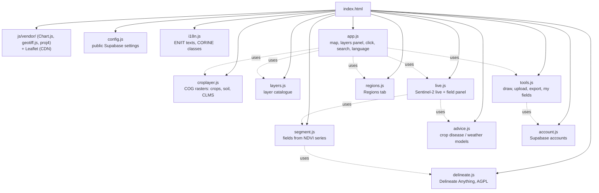
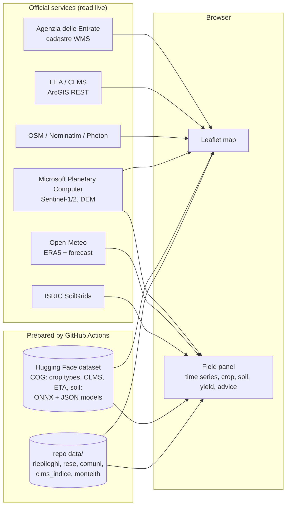
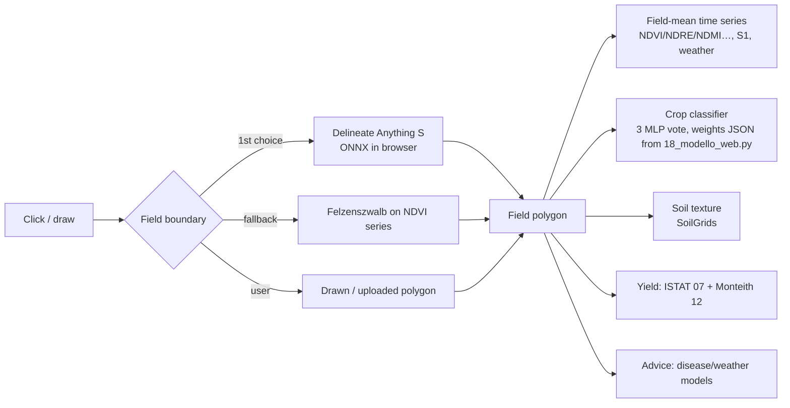
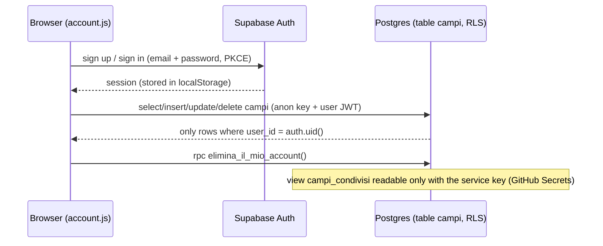

# How Columella works

Columella is a **static website** (GitHub Pages: HTML + plain JavaScript, no build step, no server of its own).
Every computation for the user runs **in the browser**; heavy, slow jobs run **once in GitHub Actions** (Python scripts in
`pipeline/`) and their results are published as files (in `data/` of this repo or in the Hugging Face dataset
`Bradipo92/campi-aperti-data`). Italian version: [COME_FUNZIONA.md](COME_FUNZIONA.md).

## 1. Site structure

Scripts are loaded in this order by `index.html` and share globals (`LANG`, `Live`, `Tools`, `Account`, …).
The `?v=NN` suffix on each script forces browsers to reload after a change.

## 2. Data flow

### Cadastre
`layers.js` (`type: "catasto"`) → WMS INSPIRE of Agenzia delle Entrate, tiles requested in EPSG:4258. Parcels are drawn only at
large scales; a click opens the parcel sheet in a new window (the service has no CORS).

### Copernicus
- **CLMS / EEA layers** (CORINE, CLC+, tree cover, grassland, phenology…): `layers.js` → ArcGIS `export`/`exportImage`, `identify`, `legend`.
- **Biogeophysical variables and ETA** (NDVI, LAI, FAPAR, ET…): `pipeline/16_clms_italia.py` clips them on Italy as COG → Hugging Face;
  `17_indice_clms.py` writes `data/clms_indice.json` (available dates); `croplayer.js` reads only the needed bytes (HTTP range) with geotiff.js.
- **HRL Crop Types**: `01`→`02` build one COG per year (`crop_types/cty_YYYY_italia_3035.tif`), drawn by `CropLayer`.
- **Sentinel-2 live**: `live.js` registers a mosaic on Planetary Computer (last 10–90 days, clouds < 20 %) for natural/false colours and indices.

### Weather
Open-Meteo (ERA5 archive + 7-day forecast) is called directly from the browser for the selected field (`live.js`, `advice.js`).
Regional summaries come from `04_meteo_celle.py` → `05_bilancio_regioni.py` → `data/riepiloghi.json` (`regions.js`).

### Fields and crop models

Values are always **means over the whole field** (clouds and shadows masked with the Sentinel-2 SCL class).
The crop classifier is trained offline (`13_dataset_v2.py` → `14_addestra_v2.py` → `18_modello_web.py`).

## 3. Supabase (optional accounts)

- `js/config.js` holds only the **public** URL and anon key; if empty, accounts are off and fields stay in `localStorage`.
- Security is in `supabase/schema.sql` (Row Level Security). Setup: `SUPABASE.md`. Privacy notice: `privacy.html`.

## 4. File → what it does

| File | What it does |
|---|---|
| `index.html` | Page skeleton, loads scripts in order |
| `css/style.css` | Styles |
| `js/config.js` | Public Supabase settings (URL, anon key) |
| `js/i18n.js` | EN/IT interface texts, CORINE class names, "coming soon" catalogue |
| `js/layers.js` | Layer catalogue (groups, URLs, texts, sources) |
| `js/app.js` | Map, base maps, layer panel and styles, point click, search, language, shareable URL |
| `js/croplayer.js` | COG raster layers in the browser: Crop Types, soil, CLMS; colour ramps |
| `js/live.js` | Live Sentinel-2/1 layers, field panel: time series, crop, soil, yield, water balance, CSV |
| `js/segment.js` | Field segmentation from the Sentinel-2 NDVI series (fallback) |
| `js/delineate.js` | Field boundaries with Delineate Anything S (ONNX, AGPL-3.0, downloaded at use time) |
| `js/advice.js` | Agronomic alerts per crop from hourly weather |
| `js/regions.js` | "Regions" tab: summaries by region, crop and period; Monteith vs ISTAT |
| `js/tools.js` | Draw/upload fields and maps, export area, "my fields", lawn tool, welcome |
| `js/account.js` | Supabase accounts, saved fields, export and deletion |
| `supabase/schema.sql` | Table `campi`, RLS policies, account deletion, shared view |
| `pipeline/00`–`02` | Crop Types: download from CDSE, Italy COG, upload to HF |
| `pipeline/03`–`05` | Crop areas per 1 km block, weather cells, regional balances → `data/riepiloghi.json` |
| `pipeline/06` | Copernicus actual ET per region and crop |
| `pipeline/07` | ISTAT yields per province → `data/rese.json` |
| `pipeline/10`, `12` | Province NDVI and Monteith yield model vs ISTAT |
| `pipeline/11` | Export Delineate Anything S to ONNX (AGPL-3.0) |
| `pipeline/13`, `14`, `18` | Crop classifier: dataset, training, browser weights |
| `pipeline/15` | Municipality index for search → `data/comuni.json` |
| `pipeline/16`, `17` | CLMS variables on Italy (COG) and date index |
| `pipeline/19` | SoilGrids soil maps for Italy (COG) |
| `pipeline/classi.py` | Crop Types classes and crop coefficients |
| `pipeline/hf_sync.py` | Sync working folders with the Hugging Face dataset |
| `.github/workflows/*.yml` | GitHub Actions that run the pipeline, collect contributions, test the site |
